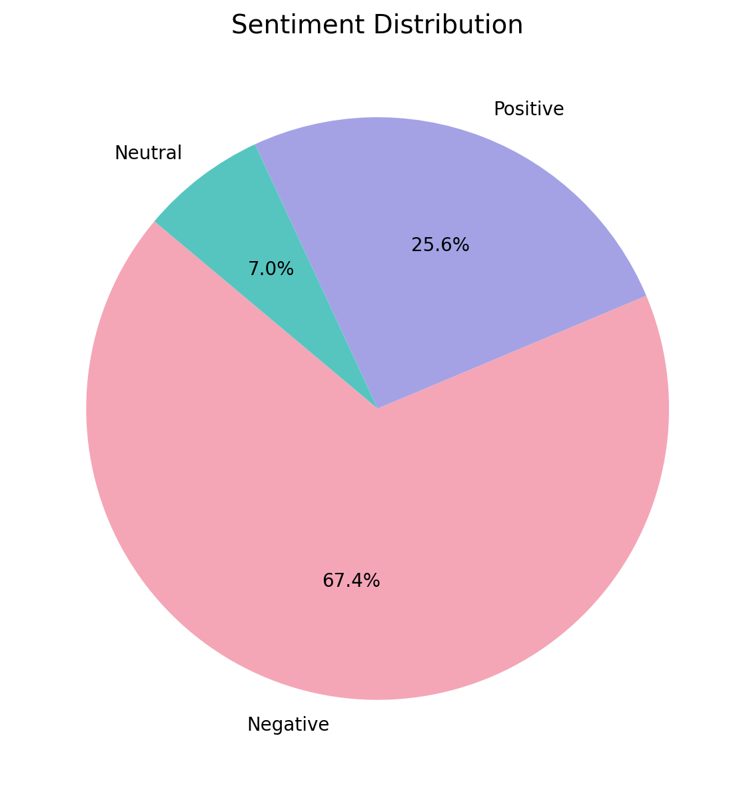
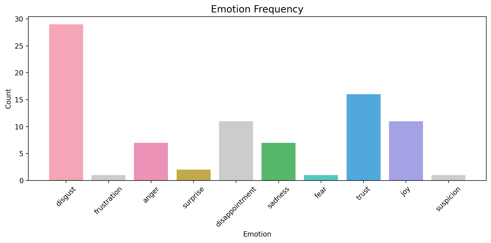
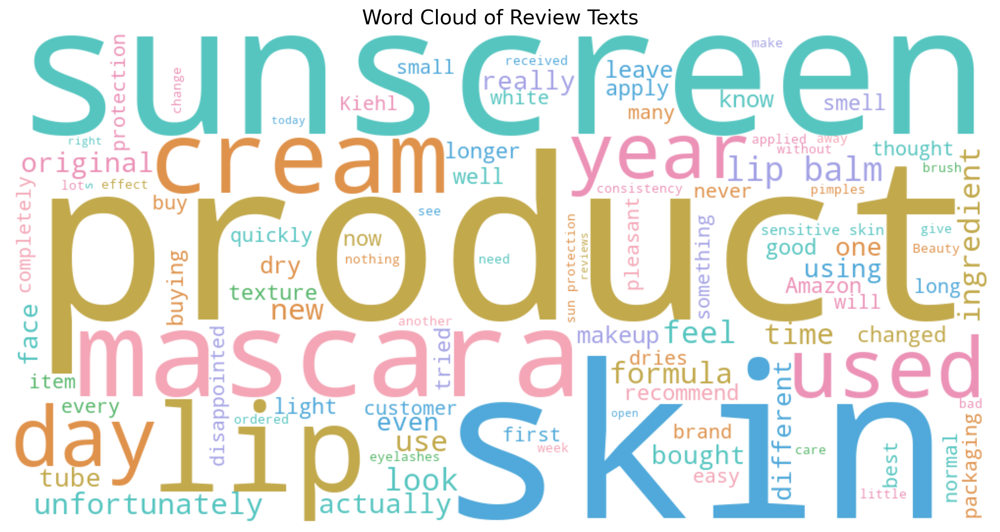

# Affective Discourse Analysis in Beauty Product Reviews Using GPT-4o

This academic project explores how GPT-4o classifies sentiment and identifies emotions in user-generated beauty product reviews.

Developed for the course **LLMs, GPT and the Humanities** at TU Darmstadt (Summer Semester 2025).

## Project Overview

- **Objective:** Explore how GPT-4o interprets emotional expressions in consumer reviews.
- **Methodology:** Prompt-based, zero-shot sentiment and emotion classification.
- **Dataset:** 43 reviews covering three beauty products:
  - Kiehl's Lip Balm
  - Beauty of Joseon Sunscreen
  - Lancôme Hypnôse Mascara
- **Tools:** Python, OpenAI API, Pandas, Matplotlib, WordCloud.

## Repository Files

| File | Description |
|---|---|
| `Annotated_Reviews.xlsx` | Review dataset with existing GPT-generated annotations |
| `gpt_sentiment_analysis-4.py` | Script for GPT-based sentiment and emotion analysis |
| `VISUAL4.py` | Script for generating visualizations |
| `README.md` | Project documentation |


## Visualizations

The following figures were generated using Python and the existing GPT-4o annotations from 43 beauty product reviews.

### 1. Sentiment Distribution



### 2. Emotion Frequency



### 3. Word Cloud



**Note:** Sentiment and emotion classifications were generated by GPT-4o and have not been independently validated.


## How to Run

### 1. Install dependencies

```bash
python3 -m pip install -r requirements.txt
```


### 2. Generate visualizations

The repository includes an annotated Excel workbook, so you can start with the visualization script:

```bash
python3 VISUAL4.py
```

### 3. Optional: Run GPT analysis again

The `gpt_sentiment_analysis-4.py` script uses the OpenAI API and requires an `OPENAI_API_KEY` environment variable.

Rerunning the model generates new classifications and may incur API charges. The existing annotated workbook is sufficient for examining the original results.

Never commit API keys to GitHub.

## Academic Context

This project was developed for an academic poster presentation at TU Darmstadt.

It demonstrates an exploratory application of large language models to sentiment analysis, emotion classification, and affective discourse.


## Classification Consistency Check

The prompt instructed GPT-4o to select up to two emotions from eight predefined categories: joy, trust, sadness, anger, fear, surprise, disgust, and anticipation.

An inspection of all 43 annotated reviews found that 13 reviews (30.2%) contained at least one emotion outside this predefined taxonomy.

The additional labels were:
- Disappointment: 11 occurrences
- Frustration: 1 occurrence
- Suspicion: 1 occurrence

This reveals a limitation in the model's adherence to the classification instructions. The original outputs are preserved for transparency.

This check evaluates taxonomy compliance, not the accuracy of the emotion classifications.


## Limitations

- The dataset contains only 43 reviews.
- GPT-generated classifications may contain errors or inconsistencies.
- Results are exploratory and should not be generalized to all consumers or beauty products.
- Independent human annotation would be needed to evaluate classification accuracy.
